# Baton — Claude Code 에이전트 패키지

기획서 한 장으로 풀 플로우 프로토타입(prototype.html) + 시나리오 플로우 문서(scenario-flow.html)를 자동 생성하는 Claude Code 에이전트 시스템.

---

## 설치

### 원격 설치 (GitHub에서 직접)

```bash
curl -fsSL https://raw.githubusercontent.com/lilconan/baton/main/install.sh | bash
```

### 로컬 설치 (레포 clone 후)

```bash
git clone https://github.com/lilconan/baton.git
bash baton/install.sh
```

설치 위치: `~/.claude/agents/` + `~/.claude/skills/`

한국어 문체 린터 `hanlint`는 선택 사항입니다. 설치되어 있으면 이 레포의 훅(`.claude/settings.json`)이 문서 저장과 답변마다 번역투를 검사하고, 없으면 훅이 아무것도 하지 않습니다.

---

## 프로젝트에 적용

새 프로젝트 루트에 CLAUDE.md와 PROCESS.md를 복사하면 Claude Code가 자동으로 규칙을 적용합니다.
`PROCESS.md`는 STEP 0 입력 게이트가 참조하는 필수 파일이므로 함께 복사해야 합니다.

```bash
BASE=https://raw.githubusercontent.com/lilconan/baton/main
curl -fsSL $BASE/CLAUDE.md  -o CLAUDE.md
curl -fsSL $BASE/PROCESS.md -o PROCESS.md
```

---

## 워크플로우



STEP 0은 입력을 FIXED/OPEN으로 나누고, 필수 기능마다 근거가 있는지 추적합니다. STEP 4는 `prototype.html`(A/B/C 탭 통합 프로토타입)과 `scenario-flow.html`(시나리오 기반 플로우 문서)을 함께 만듭니다.

**입력이 아무리 상세해도 STEP 0을 건너뛰지 않습니다.** 기획서가 자세하다는 것은
검증되지 않은 결론이 많다는 뜻이므로, 와이어프레임을 그리기 전에 먼저
`docs/{프로젝트}/`에 기획 문서를 남깁니다. → `PROCESS.md` §2, R9

### 분기까지 담은 순서도

사용자 확인에서 되돌아가는 길, 선택 단계, 산출물까지 모두 표준 순서도 기호로 그렸습니다. 그림을 누르면 원래 크기로 열립니다.

<details>
<summary>1쪽: 전체 흐름 (STEP 0~5)</summary>

[](assets/baton-process-1.svg)

</details>

<details>
<summary>2쪽: STEP 0 상세 (확인 A·B·C)</summary>

[](assets/baton-process-2.svg)

</details>

---

## 포함 파일

| 파일 | 역할 |
|---|---|
| `.claude/agents/baton.md` | 오케스트레이터 (STEP 0→2→3→4 관리) |
| `.claude/agents/baton-interpreter.md` | STEP 2: 기획서 해석 |
| `.claude/agents/baton-designer.md` | STEP 3: A/B/C 레이아웃 설계 |
| `.claude/agents/baton-builder.md` | STEP 4: 프로토타입 빌드 |
| `.claude/skills/baton-tokens.md` | 모노크롬 팔레트·컴포넌트 정의 |
| `.claude/skills/baton-shell.md` | createMobileApp + 플로우뷰 JS |
| `.claude/skills/korean-copy-guardrail/` | 한국어 카피 규칙 (빌더·해석·설계 에이전트가 선적재) |
| `CLAUDE.md` | 프로젝트 규칙 (설치 시 템플릿으로 복사) |
| `PROCESS.md` | 기획 프로세스 표준 — 더블 다이아몬드, 출처 등급, FIXED 처리 (**STEP 0 필수 참조**) |
| `RUNBOOK.md` | 단계별 프롬프트 모음 (사람이 읽는 것) |
| `START_HERE.md` | 온보딩 가이드 |
| `CONTEXT.md` | 프로젝트 컨텍스트 |
| `shell.html` | 온다 레퍼런스 구현체 (모노크롬 참고) |
| `docs/{프로젝트}/` | 기획서 원본 |
| `output/{프로젝트}/` | STEP 2~4 산출물 |
| `publish.sh` | 이 레포로 발행 (git subtree push) |

---

## 출력 규칙

- **모노크롬 전용** — 유채색 없음, #1a1a1a ~ #ffffff
- **단일 HTML** — 빌드 없음, CDN만 (Tailwind v4 + Lucide + Pretendard)
- **A/B/C 탭 통합** — 한 파일에 3개 안 탭 전환
